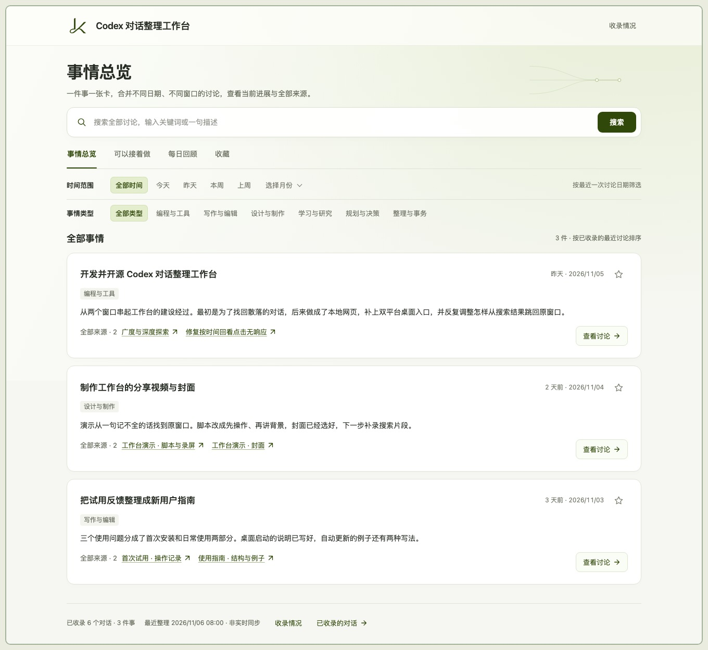
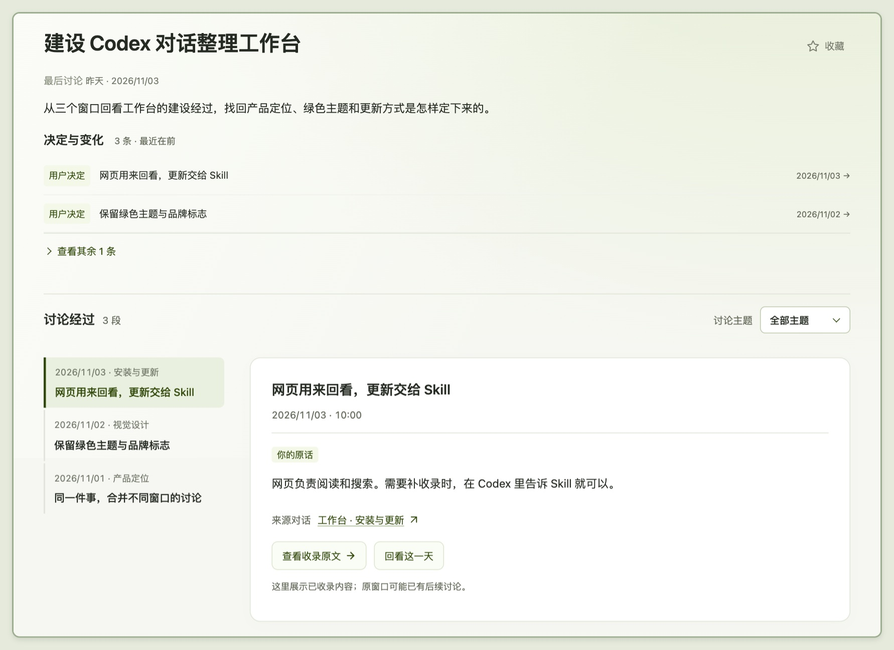
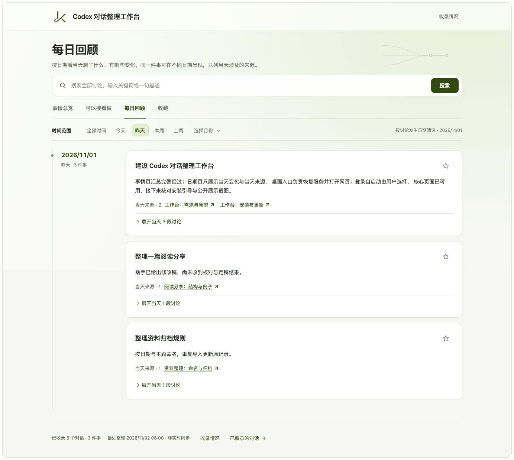
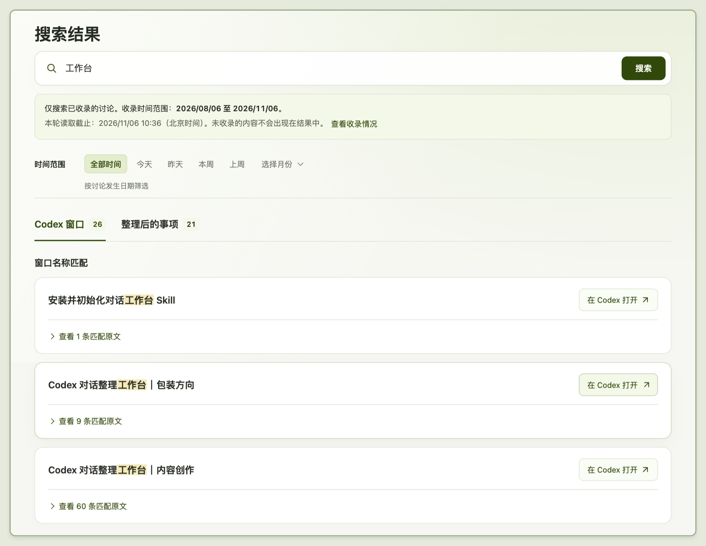
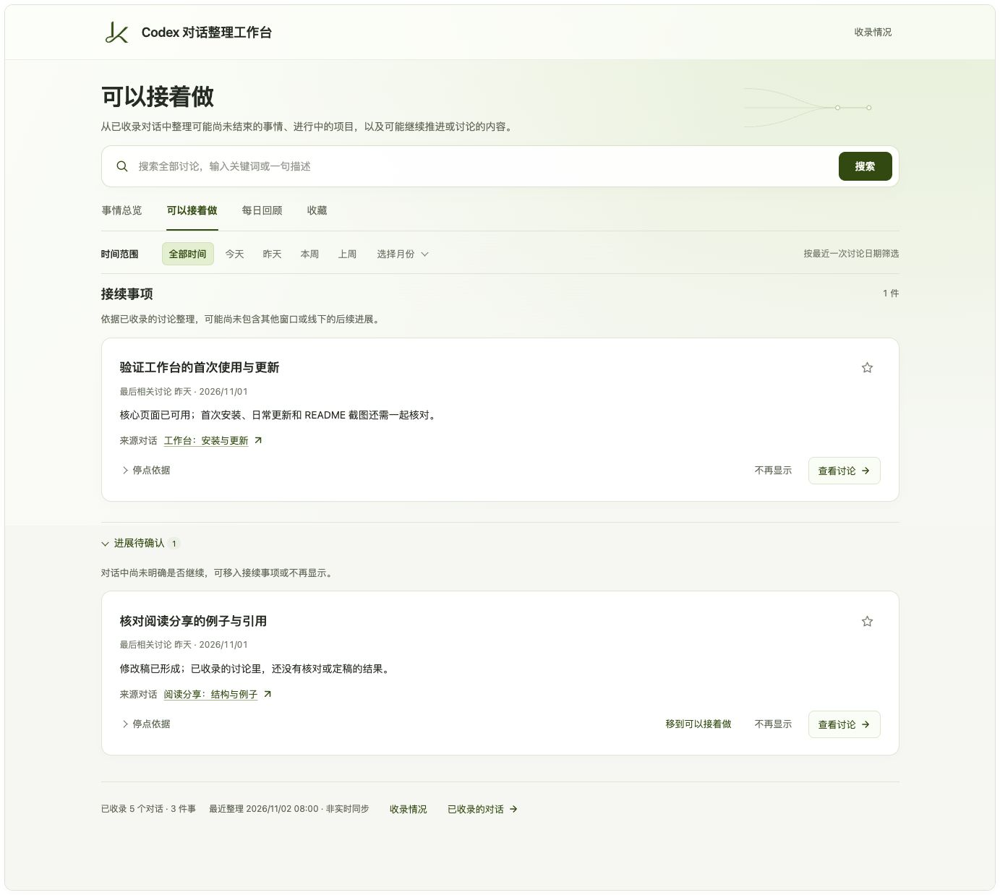
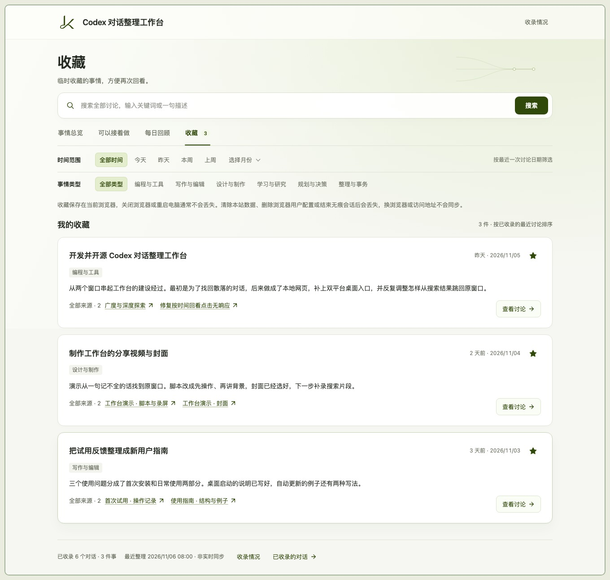

# Codex 对话整理工作台

这个 Skill 把你在 Codex 里聊过的事整理成一个本地网页。**同一件事聊了几个窗口，也能放在一起看**：从小结和关键决定回到当时的原话，或按日期回顾那天做了什么。

只记得几个词，可以搜索已收录的对话；隔了几天想接着做，可以查看上次停在哪里，一键跳回原来的 Codex 窗口。

[复制安装指令](#开始使用) · [三个使用场景](#三个使用场景) · [常见问题](#常见问题)



*出于隐私考虑，图中部分示例内容使用了模拟数据。*

## 三个使用场景

### 1. 一件事聊了好几个窗口，想看清它是怎么定下来的

- **按事情看。** 在「事情总览」选一件事，先读小结，再看关键决定和讨论经过。想知道某个决定是怎么来的，点一下就能回到对应的原话。



- **按日期看。** 如果你只记得是哪天聊的，打开「每日回顾」，选中日期，就能一起看到那天推进的几件事。展开其中一件，可以查看当天的讨论。



### 2. 明明聊过，却忘了窗口名，也记不清原话

- **用记得的词搜。** 输入关键词或一句大概的描述。在「Codex 窗口」找原对话，在「整理后的事项」找围绕同一件事的讨论。搜索框下方列出了已收录的日期范围。
- **看看是不是那次讨论。** 先读小结，再展开匹配片段看前后文。如果直接命中的结果都不对，还可以看「可能是你要找的」里的相近候选。
- **回原窗口继续。** 点击带 ↗ 的来源对话名，就能在 Codex 打开对应窗口。



### 3. 过了几天，想知道上次停在哪里、还有什么可以继续

打开「可以接着做」，可以看到上次讨论停在哪里。

- **接续事项。** 有明确下一步的事情列在这里。点「停点依据」核对当时的讨论，再回原窗口继续。
- **进展待确认。** 如果记录里看不出还要不要继续，可以把它移入接续事项，或选「不再显示」。



**想留到下次再看**，点事项旁的 ☆，之后从「收藏」直接打开。收藏保存在当前浏览器，普通重启通常会保留，清除本站数据后会丢失。



## 开始使用

你需要在电脑上使用支持本地 Skill 的 Codex。**Skill 就是一套交给 Codex 执行的操作流程**，安装和整理都可以让它帮你完成，不用自己写代码。

### 1. 把这段话发给 Codex

新建一个对话，复制下面这段发送：

```text
请安装这个 Skill，并带我完成首次初始化：
https://github.com/LuKK351/codex-chat-workbench
```

### 2. 选择先整理哪些讨论

Codex 会让你确认时间范围、保存位置和分类。保存位置与分类都有建议，可以直接沿用。

建议从 **近 1 个月** 开始，先看看整理效果；如果你只是偶尔使用 Codex，也可以选近 3 个月。想找更早的内容，可以直接指定日期。

<details>
<summary>不知道选多长时间？展开看看适合你的范围</summary>

| 整理范围 | 适合的情况 | 建议 |
| --- | --- | --- |
| **近 1 个月（推荐起步）** | 你几乎每天都在 Codex 里讨论或处理事情，已经积累了不少窗口；想先看看这些内容整理成工作台后的效果。 | 先整理近期内容，确认小结、分类和查找方式是否符合需要，再补充更早的讨论。 |
| **近 3 个月** | 你只是偶尔使用 Codex，最近一个月的内容不多；或者需要一起回看过去几个月持续推进的事情。 | 覆盖更长一段时间。如果每天都有大量讨论，首次整理也可能需要较长时间。 |
| **自选时间范围** | 你已经知道想找哪个时期的内容，例如半年前讨论过的一个方案。 | 直接选择相关日期，不必为了找旧讨论，把中间所有月份都整理一遍。 |

</details>

### 3. 点击固定入口，开始使用

- **首次打开。** 首批整理好后，Codex 会给你网页地址，并继续整理选定范围。讨论越多、正文越长，首次等待通常越久。过程中会告知进度，遇到中断会保存恢复点。
- **下次打开。** 在 macOS 和 Windows 上，双击桌面的「打开 Codex 工作台」，服务停止时也能自动恢复。在 Linux 上可以请 Codex 帮你打开。
- **用常用浏览器。** 收藏和接续事项的确认、移出选择保存在当前浏览器。固定使用同一浏览器和地址，下次就能看到之前的选择。
- **习惯点书签？** 可以让 Codex 开启「登录电脑后自动启动」，让本地网页随时可访问。对话收录另按下面的方式更新。

## 以后怎么更新

- **补收新讨论**，对 Codex 说「更新一下我的对话整理工作台」。想找更早的讨论，也可以告诉它要补哪段日期。
- **定时更新**，首次整理结束后，Codex 会问你是否设置。你也可以随时说「帮我设置每天早上 8 点更新工作台」。需要当前 Codex 环境支持定时任务，并在运行时可用。

## 常见问题

<details>
<summary>会修改原对话，或者把我的内容公开吗？</summary>

不会删改原来的 Codex 对话。工作台文件保存在你的电脑上，安装这个公开仓库也不会把聊天上传到 GitHub。整理仍由你的 Codex 环境处理，不代表 AI 整理完全离线。

分享给朋友时，发送本仓库链接即可，不要分享装有私人内容的工作台文件夹。

</details>

<details>
<summary>能整理全部历史吗？包含 ChatGPT 和图片吗？</summary>

首次由你选择时间范围，实际覆盖取决于当前环境能读取哪些正文。读不到或不完整的部分会说明，不会拿摘要冒充原话。目前整理 Codex 对话，不包含 ChatGPT 对话和附件正文。

</details>

<details>
<summary>重启电脑，收藏会消失吗？</summary>

普通重启通常不会。收藏保存在当前浏览器；清除本站数据、删除浏览器用户配置或结束无痕会话后会丢失。换浏览器或网页地址不会自动同步，适合临时回看。

</details>

<details>
<summary>Windows、macOS 和 Linux 都能用吗？</summary>

网页与整理脚本已做三个系统的兼容处理；固定桌面入口和可选登录自启动面向 macOS、Windows，Linux 可通过 Codex 打开。目前 macOS 已实测，Windows 与 Linux 的验证范围见技术说明。安装时 Codex 会检查必要环境，遇到问题可把提示发给它继续处理。

</details>

<details>
<summary>安装后找不到 Skill，或者网页打不开了怎么办？</summary>

安装后尚未识别 Skill，可以新建对话或重新打开 Codex，再发：

```text
使用 $codex-chat-workbench，帮我建立对话整理工作台。
```

先点桌面的“打开 Codex 工作台”，它会自动检查并恢复服务。直接点击浏览器书签需要服务已经运行，可按需开启登录后自动启动。

老版本还没有固定入口，或入口弹出错误提示时，对 Codex 说“帮我修复已有工作台的打开入口”。已有内容不用重新整理；把错误提示或启动诊断文件交给它即可。

</details>

---

[技术说明](docs/technical.md) · [反馈问题](https://github.com/LuKK351/codex-chat-workbench/issues)

反馈时请隐去私人对话、个人路径和其他敏感信息。

本项目采用 [MIT 许可证](LICENSE)，版权署名为 LuKK（困困卢）。
